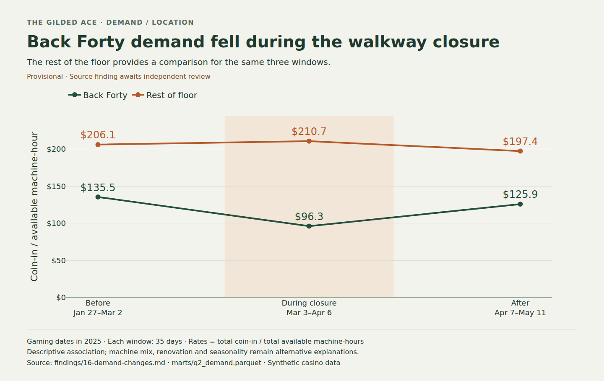

# The Gilded Ace: luck, location, or a leak?

Management wants to replace the lowest-earning machines. Our Streamlit dashboard compares the manager's picks with adjusted machine rankings, investigates luck, location and downtime, prices a July action plan and evaluates a demand forecast. **Headline:** Back Forty coin-in per available machine-hour fell from **$135.5 before the walkway closure to $96.3 during it**, while the rest of the floor went from **$206.1 to $210.7** ([finding, comparison windows and queries](findings/16-demand-changes.md)). This descriptive result carries a named check (Alex, Claude Code, Opus 5.5; claims 1 and 3 of that finding); it supports investigating access before blaming machines, rather than establishing a causal effect.

[](figures/README.md)

## Live dashboard

Public URL: **https://datathon-dashboard-o5xb3rbuuqzppphcqeglmq.streamlit.app/** (free tier: the first visit after idle takes about a minute to wake). Deployment notes and verification: [findings/24-deploy.md](findings/24-deploy.md). The 400-word submission [write-up](docs/writeup.md) summarises the result. To run locally, see below.

## What we built

An interactive dashboard over a fictional casino's synthetic gaming, operations and guest records. Pages read committed derived parquet marts, so viewing the app does not require raw data. Machines, Demand, Downtime, Players, Comps, Actions and Model are implemented. Use each page's period filter, drill controls and source expander to trace the analysis. Implementation is complete for these pages. Each section below links its findings; check status is recorded per claim (see [Data and analytical approach](#data-and-analytical-approach)).

### Machines: which underperform after adjustment?

Open **Machines** to compare the manager's bottom ten by total house win with expected contribution per available hour, then change the period or drill into a bank. Explore the variance-adjusted payout screen and same-game location comparisons. Rankings are descriptive screens; they establish neither a replacement benefit nor wrongdoing. Evidence, each with a named check: [rankings and baseline](findings/22-machines.md), [location comparisons](findings/31-location.md) and [payout screen](findings/32-leak-screen.md).

### Demand: what changed across the floor?

Open **Demand**, change the period and drill into Back Forty to examine the walkway closure alongside floor demand. The headline above uses before/during/after windows and the rest of the floor as a comparison. Machine mix and renovation effects remain alternative explanations. [Evidence and limitations](findings/16-demand-changes.md): the closure and June-softening claims are checked; the event-lift figures in that finding remain unchecked (#74).

### Downtime: how much availability was lost?

Open **Downtime** to compare lost hours, estimated lost play and repair patterns by manufacturer, bank or zone. Lost-play estimates use the same machine's available-hour play rate within the month; guest substitution can reduce the recoverable opportunity. [Evidence and baseline](findings/17-downtime.md).

### Players: what did tracked guests experience?

Open **Players** to inspect wagers, payouts, net outcomes and concentration against an equal-share baseline, then drill into a guest group. Carded records do not describe uncarded guests; wagers include replayed winnings and are not cash spent. These summaries are for understanding outcomes, never for encouraging heavy losers to play more. [Evidence and definitions](findings/18-player-outcomes.md).

### Comps: what did loyalty rewards cost?

Open **Comps** to compare economic cost with menu value, inspect redemption intensity over time and drill by opening tier or home region. The baseline is earlier-period redemption intensity. Comp costs are already inside POS cost of goods sold and must be subtracted only once. [Evidence and reconciliation](findings/19-comps.md).

### Actions: what should management fund?

Open **Actions** to inspect the proposed payout/configuration inspection and compare its price and downtime with preserving all funds, preventive maintenance and extra technician coverage. Change the evidence period, drill into an option and trace its measurement plan and source findings. Recovery scenarios are assumptions, and the monetary comparison favors preserving all funds; the inspection buys information without an estimated positive revenue recovery. Budget preserved is not savings. [Plan, prices, baselines and limitations](findings/23-july-actions.md).

### Model and validation

Open **Model** to compare a fitted weekday-plus-trend regression with constant and weekday-mean baselines. Training uses January–April; frozen forecasts are evaluated on May–June using mean absolute error. Change the evaluation period to recalculate selected-period scores and drill into errors by month or weekday. Inputs use calendar dates only. The weekday-mean baseline has the lowest observed holdout error; future superiority is unproven. [Evaluation, target reconciliation and limitations](findings/47-forecast-evaluation.md).

## Data and analytical approach

Source: the organizer's [Dashboard Royale repository](https://github.com/tamu-datathon-org/dashboard-royale); start with its GUIDE.md and data dictionary. Prepared daily/property views and player-period records are supplemented by machine placements, game math, calendar, operations, traffic and loyalty records. Raw data stays outside version control; builders read it through `DATA_DIR`.

Money calculations use `royale/money.py`: aggregate ratios use sums, theoretical win uses configured game RTP, and luck is observed house win minus theoretical win. Machine comparisons exclude off-floor records, follow dated placements and use available hours. Contextual associations are descriptive; unusual payouts are inspection leads, not accusations.

**Check status.** Each finding's `Checked by` line is the record, and the [Claims & Evidence appendix](docs/claims_evidence.md) copies it claim by claim with each claim's table or query, result, alternative explanation and limitation. Findings 17, 18, 19, 20, 22, 23, 31, 32, 33, 34 and 47, and claims 1 and 3 of finding 16, name a teammate who re-ran them with Claude Code. Findings 81 and 86 were checked by independent Codex agents, not a human. Still `unchecked`: the event lifts in finding 16 (#74), the deployment record (24) and the public-URL judge-path run (70). Named checks are tool-assisted re-runs, not separate human audits. The [AI-use disclosure](docs/ai_disclosure.md) states which tools the team used and for what.

## Setup and run

These commands follow [SETUP.md — Stack setup](SETUP.md#stack-setup). Install git and [uv](https://docs.astral.sh/uv/getting-started/installation/) first. From a fresh checkout:

```bash
git clone https://github.com/shaswat-singh23/datathon-dashboard.git
cd datathon-dashboard
uv sync
uv run pytest -q
uv run streamlit run app.py
```

The app uses the committed `marts/`. To rebuild them, stop Streamlit and fetch the organizer data:

```bash
git clone --depth 1 https://github.com/tamu-datathon-org/dashboard-royale.git
cp .env.example .env
# Edit .env: set DATA_DIR to the absolute path of dashboard-royale/data.
uv run python -m royale.build
uv run pytest -q
uv run streamlit run app.py
```

Data-dependent tests skip when raw data is unavailable. Never commit raw data or secrets. Dependencies and the Python requirement are declared in [pyproject.toml](pyproject.toml) and locked in [uv.lock](uv.lock).

## Team workflow

[AGENTS.md](AGENTS.md) defines issue scope, review and evidence rules; [PLAYBOOK.md](PLAYBOOK.md) describes team coordination. A number is cited in the README, slides or video only from a finding whose `Checked by` is not `unchecked`.
